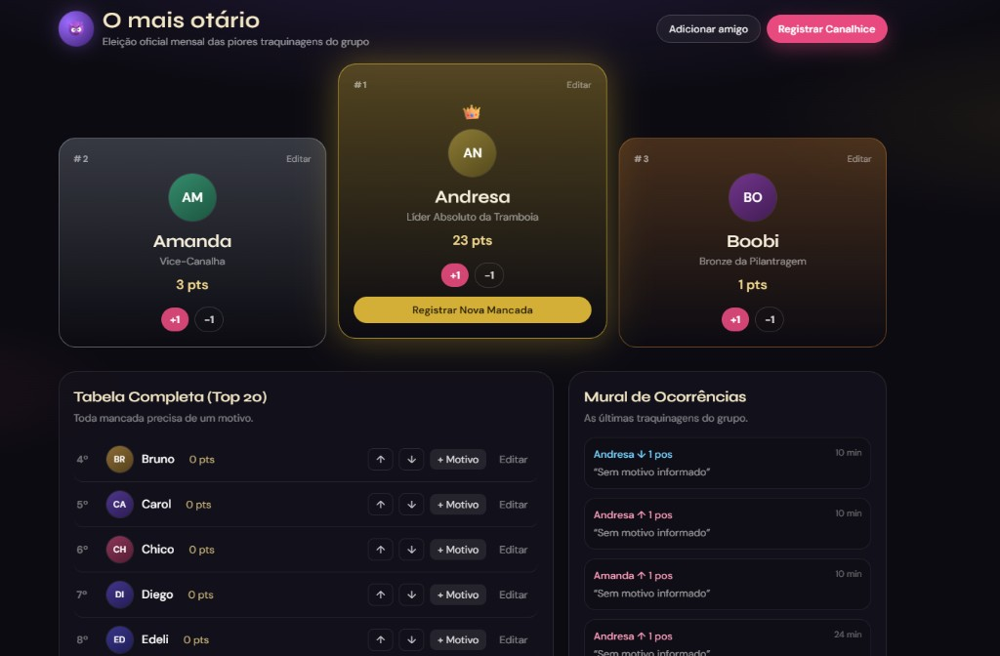

# O mais otário

Eleição oficial mensal das piores traquinagens do grupo.



App Next.js para ranquear quem é o maior otário do rolê. Aberto pra quem tiver o link — sem login. Toda mancada exige motivo.

## Stack

- Next.js (App Router) + TypeScript + Tailwind
- SQLite local em Docker/dev (`file:/data/local.db`)
- Turso (SQLite na nuvem) em produção na Vercel

## Rodar

```bash
docker compose up
```

Abre [http://localhost:3000](http://localhost:3000).

O código é montado no container; o nodemon reinicia o Next ao salvar (necessário no Docker Desktop no Windows).

```bash
docker compose down          # parar
docker compose restart       # se a UI parecer presa
docker compose down -v       # resetar o banco
```

Sem Docker:

```bash
npm install
npm run seed
npm run dev
```

## Seed

Edite `lib/seed-friends.json` e rode `npm run seed` (apaga amigos/ocorrências e reinsere a lista). No dia a dia, use Adicionar / Editar no app.

## Deploy (Vercel)

1. Crie um DB no [Turso](https://turso.tech)
2. Importe o repo na [Vercel](https://vercel.com)
3. Env vars: `TURSO_DATABASE_URL`, `TURSO_AUTH_TOKEN`
4. Seed de produção:

```bash
TURSO_DATABASE_URL=... TURSO_AUTH_TOKEN=... npm run seed
```

Máximo de **25** amigos.
